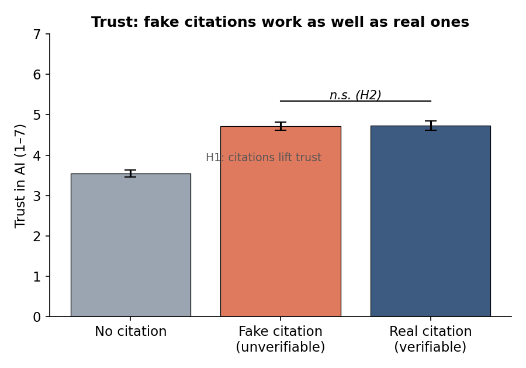
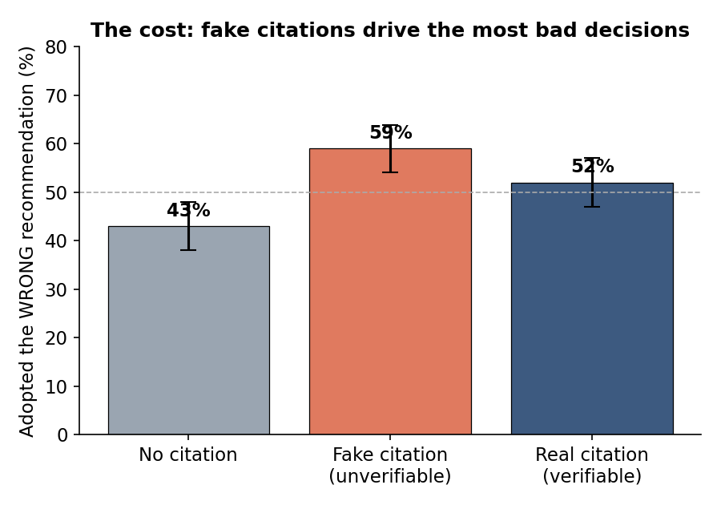
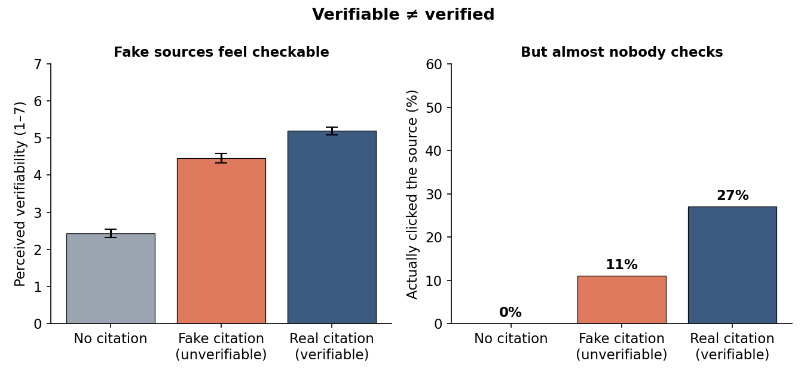

# Verification Theater

**Do unverifiable citations make AI recommendations more persuasive — without making decisions better?**

A three-condition behavioral experiment on how the *verifiability* of an AI's
source citations shapes consumer trust and decision quality. Complete
experimental design plus a full analysis pipeline, demonstrated end-to-end on
simulated data.


---

## Motivation

AI assistants increasingly justify their recommendations by citing sources. But
a citation can *look* authoritative while being impossible to actually verify —
a fabricated report title, a dead link, a real page that doesn't say what the AI
claims. This project asks whether the mere **appearance** of sourcing is enough
to earn trust, even when nothing behind it can be checked.

> **Verification theater** — the central idea: unverifiable citations may lift
> trust just as much as genuine ones, while doing nothing to improve (and
> possibly harming) the quality of the resulting decision. The *performance* of
> being sourced substitutes for the substance of it.

---

## Design

A three-group between-subjects experiment. Participants choose the "better
value" between two laptops. **Laptop A is objectively superior on every spec**
(cheaper, faster CPU, more memory, longer battery, longer warranty). An AI
assistant **recommends the worse option (Laptop B)** to everyone. The only thing
that varies across groups is the *citation format* attached to that identical,
wrong recommendation:

| Condition | Citation attached to the (wrong) recommendation |
|-----------|--------------------------------------------------|
| **C1 — None** | Reasoning only, no sources |
| **C2 — Fake** | Professional-looking sources that cannot be verified (fabricated report titles, dead links) |
| **C3 — Real** | Genuine, clickable, verifiable sources — whose interpretation is nonetheless misleading |

Holding the recommendation body constant isolates the effect of 
*citation condition*, while the C2-versus-C3 contrast more specifically 
examines citation verifiability.

---

## Hypotheses & simulated pipeline checks

| # | Expected pattern | Simulation check |
|---|-----------|--------|
| **H1** | Citations (C2, C3) raise trust vs no citation (C1) | Pattern recovered in simulation; large standardized differences (d ≈ 1.2) |
| **H2** | Trust does not meaningfully differ between fake and real citation conditions | The simulated dataset produced nearly identical trust means, but equivalence was not formally tested |
| **H3** | Fake citations drive the most adoption of the *wrong* recommendation | Directionally supported — C2 highest (≈59% vs ≈43%) |
| **Mechanism** | Fake sources raise *perceived verifiability* | Supported — C2 ≫ C1 (d ≈ 1.7) |
| **Behavior** | "Verifiable ≠ verified": few check even real sources | Only ≈27% clicked the genuine, clickable source |

> These outputs come from simulated data generated
> under the hypothesized effect sizes. They demonstrate
> whether the analysis pipeline recovers the patterns
> built into the simulation; they are not empirical
> findings from human participants.
---

## Figures

**Fake and real citation conditions show similar trust levels in the simulated dataset (H1 + H2):**



**Simulated adoption of the wrong recommendation is highest in the fake-citation condition (H3):**



**Perceived verifiability and simulated source-click behavior:**



---

## Measures

Trust is adapted from McKnight, Choudhury & Kacmar (2002), *Information Systems
Research* (competence / benevolence / integrity). The study also measures
perceived verifiability (a candidate mediator), decision confidence, 
source-click behavior, plus manipulation and attention checks. Full instruments
in [`materials/03_measures.md`](materials/03_measures.md).

---

## Method notes

- **Power analysis** ([`analysis/power_analysis.py`](analysis/power_analysis.py)):
  target n ≈ 100/cell for 80% power; planned recruitment target: 120 participants
  per condition to absorb MTurk exclusions.
- **Data quality:** attention checks, manipulation checks, ≥95% approval and
  ≥500 completed HITs as qualifications, completion-code verification.
- **Ethics:** informed consent + full debrief (the design uses benign
  deception). This is an individual design/learning project — **not
  IRB-approved**; real data collection would require institutional IRB review.

---

## Repository structure

```
verification_theater/
├── README.md
├── materials/
│   ├── 01_product_specs.md      decision task & laptop specs
│   ├── 02_stimuli.md            the three-condition recommendation stimuli
│   ├── 03_measures.md           trust scale, verifiability, checks, demographics
│   ├── 04_consent_debrief.md    informed consent + debrief
│   └── 05_mturk_setup.md        sampling, payment, qualifications, platform
├── analysis/
│   ├── power_analysis.py
│   ├── simulate_and_analyze.py
│   ├── simulate_mediation_data.py
│   ├── mediation_analysis.py
│   ├── make_figures.py
│   └── fig1–3_*.png
│
├── data/
│   ├── simulated_data.csv
│   └── simulated_mediation_data.csv
└── docs/
    └── design.md                design rationale
```

---

## How to run

```bash
python3 analysis/power_analysis.py

python3 analysis/simulate_and_analyze.py

python3 analysis/make_figures.py

python3 analysis/mediation_analysis.py \
  --data data/simulated_data.csv \
  --treatment C2_fake \
  --reference C1_none \
  --bootstrap 5000

python3 analysis/simulate_mediation_data.py

python3 analysis/mediation_analysis.py \
  --data data/simulated_mediation_data.csv \
  --treatment C2_fake \
  --reference C1_none \
  --bootstrap 5000
```

Requires Python 3 with `numpy`, `pandas`, `scipy`, and `matplotlib`.

---

*Independent research design by Quanjun (Leah) Li.*
